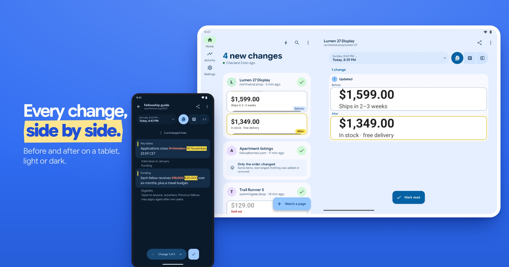

<h1 align="center">
  
</h1>

<strong>Stop refreshing. See what changed.</strong>

Watch prices, restocks, deadlines or any page you keep checking. Get an alert, open it, and see exactly what moved.

  

## The alert is just the start

  

- **Compare the way you need.** Screenshots side by side, the text that changed, or the page source.
- **Focus on one part.** Watch the section that matters and leave out ads and timestamps.
- **Keep the history.** Every check is saved, so you can go back and compare any two versions.

## When timing matters

  

For a ticket release, a restock or a deadline, **Turbo** checks the pages you pick every 5 to 60 seconds for up to three hours. It uses more battery and data, so choose the pace you need.

## On a bigger screen

  

## Your device does the checking

Watched pages, settings and history stay on your device. There is no account, no hosted service and no analytics. Websites still see the requests your device makes to check them. [Privacy policy](PRIVACY.md).

Pages that need a sign-in work while their session lasts. A check that lands on a sign-in form stops and keeps your history.

## Where it runs

| Platform | Status |
| --- | --- |
| **Android 8+** | On [Google Play](https://play.google.com/store/apps/details?id=com.bernaferrari.changedetection). |
| **Desktop** | Development build. Text checks run while the app is open. |
| **iOS** | In development. |
| **Browser demo** | The interface with sample data; it does not watch live pages. |

In English, Spanish, Italian, Portuguese, German, Hindi, Bengali and Simplified Chinese.

Screens are the real app with fictional example pages. Building from source? See [DEVELOPMENT.md](docs/DEVELOPMENT.md).
