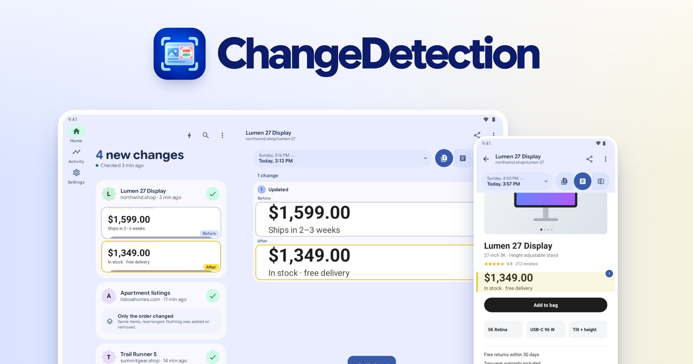
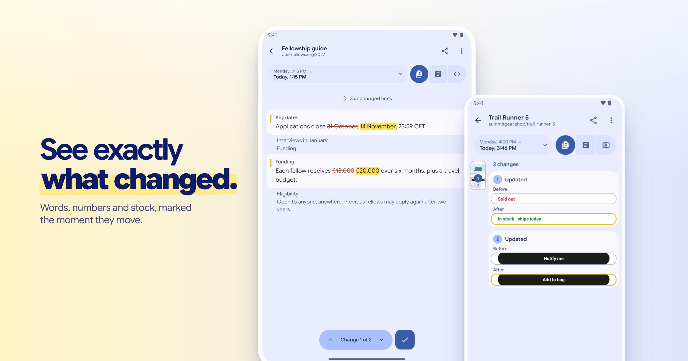
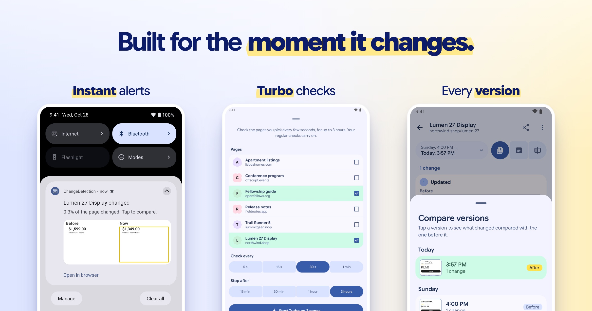

<h1 align="center">
  
</h1>

<p align="center"><strong>Stop refreshing. See what changed.</strong></p>
<p align="center">Watch prices, restocks, job listings, application deadlines, or any page you keep coming back to.<br />Get an alert, open the comparison, and see exactly what moved.</p>
<p align="center">
  <a href="https://play.google.com/store/apps/details?id=com.bernaferrari.changedetection">Get it on Google Play</a> ·
  <a href="#build-it-yourself">Build it yourself</a> ·
  <a href="https://github.com/bernaferrari/ChangeDetection/issues/new">Report a bug</a>
</p>
<p align="center">Free and open source · No account · No server to run</p>

## The notification is just the start

A page changed. Was it the price, an application deadline, or just a rotating banner? Open the saved versions and find out.

- **Compare the way you need.** See screenshots side by side, read the text changes, or compare page source.
- **Focus on one part.** Pick the section that matters and exclude noisy areas such as ads or timestamps.
- **Keep the history.** Revisit saved versions and compare an earlier change.
- **Choose the pace.** Check now, schedule regular checks, or run a short Turbo session when timing matters.





<p align="center"><sub>Screens are captured from the app with fictional example pages, not mockups.</sub></p>

## Your first watch

1. Tap **Watch a page** and open a page address.
2. Navigate to the content you care about. Choose the whole page or a selected part.
3. Review the capture, choose a comparison mode, and save it.
4. Check manually or set up automatic checks. Open a change to compare it with the previous version.

On Android and iOS, Text and Screenshot checks use the rendered browser page and its saved sign-in session. Source checks fetch HTTP without that browser session. Desktop Text checks also read the HTTP response: JavaScript-created content and browser sign-in cookies are not supported there, and setup previews use the same HTTP capture before saving. Watches that use a browser share one profile on each device, so switching accounts on a site affects its watches. Sessions can expire; a redirect to a sign-in form stops the check and keeps history. A same-address sign-in wall cannot always be distinguished from an intentional page change. Pages with extra verification may not work reliably.

For a ticket release, restock, or approaching deadline, **Turbo** checks selected pages every 5, 15, 30, or 60 seconds for up to three hours. Frequent checks use more battery and data; use the interval you actually need.

## Your device does the checking

Monitored pages, settings, and saved history stay on your device. There is no ChangeDetection account or hosted monitoring service, and the app has no first-party analytics. Websites still receive the requests your device makes to check them.

[Read the privacy policy](PRIVACY.md).

## Where it runs

| Platform | Status |
| --- | --- |
| **Android 8+** | Available on [Google Play](https://play.google.com/store/apps/details?id=com.bernaferrari.changedetection). |
| **Desktop** | Development build. Text checks run while the app is open; screenshot capture is not supported. |
| **iOS** | In development. |
| **Browser demo** | Explores the shared interface with sample data; does not monitor live websites. |

The screenshots show the current source build; features may be ahead of the published Android app. Available in English, Spanish, Italian, Portuguese, German, Hindi, Bengali, and Simplified Chinese.

## Build it yourself

This is a Kotlin Multiplatform project with a shared Compose UI. Use the checked-in Gradle wrapper.

Install an Android SDK with platform **37.2**, then set `ANDROID_HOME` or add `sdk.dir=/path/to/Android/sdk` to `local.properties`. The SDK is needed during Gradle configuration even for Desktop tasks. CI starts with Java 21; Gradle can provision the toolchains configured by the project. Desktop tasks request JetBrains JDK 25.

```sh
# Android debug APK → androidApp/build/outputs/apk/debug/
./gradlew :androidApp:assembleDebug

# Desktop app
./gradlew :shared:run

# Browser demo
./gradlew :webDemo:wasmJsBrowserDevelopmentRun
```

For iOS, open `iosApp/iosApp.xcodeproj` in Xcode. The marketing site lives in `website/` and uses pnpm; see its package scripts for development and builds.

### Check a change

```sh
./gradlew :shared:testAndroidHostTest :androidApp:lintDebug
./gradlew :shared:spotlessCheck :shared:desktopTest

# With an Android emulator or device connected
./gradlew :shared:connectedAndroidDeviceTest
```

The UI tour used for this README is reproducible with:

```sh
./gradlew :shared:desktopTest --tests '*DesignReviewTest.readmeTour'
```

It captures the real shared app UI at phone dimensions with local fixture content. See [screenshot provenance](docs/screenshots/README.md) for the source images and composition.

## Contribute

Bug reports are most useful with the app version, platform, steps to reproduce, and a public page URL when possible. Describe what you expected and what happened. Remove private page content, cookies, and account details from logs or screenshots.

For a fix, add a regression test that fails first, keep the change focused, and run the relevant checks above. Documentation, translations, accessibility improvements, and reproducible test cases are welcome too.


Localized store artwork is maintained in [Screenshot Studio](store-listing/README.md): shared layout in `store-listing/gallery.json`, words in `store-listing/<locale>/copy.json`, and native captures plus UI layout files in `store-listing/<locale>/raw/`. The editor compares languages and saves copy; strict export rejects English fallbacks and unresolved callouts. English remains the README image source.
