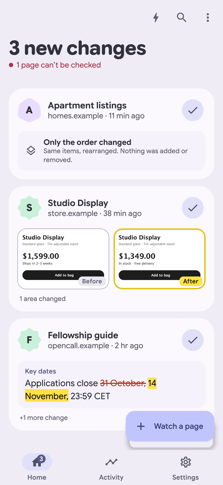
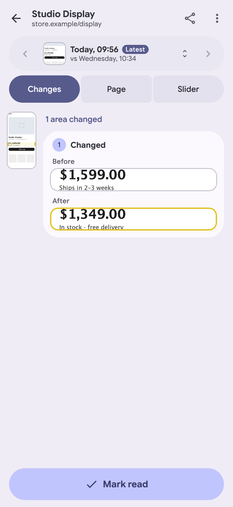
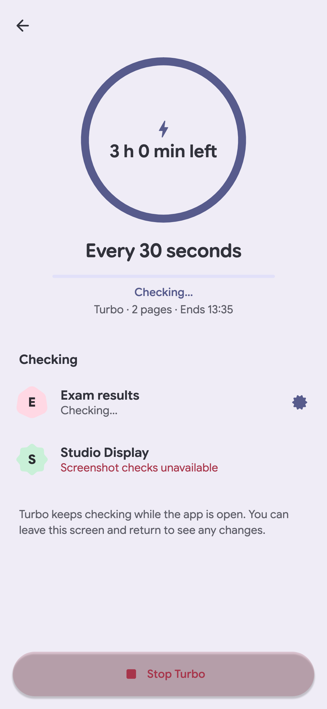

# Change Detection

Watch websites. See what changed.

Keep up with price drops, restocks, deadlines, job listings, and anything else that matters to you. Change Detection checks pages from your device, saves previous versions, and alerts you when something changes.

**Free and open source. No account, cloud service, or first-party tracking.**

[Get it on Google Play](https://play.google.com/store/apps/details?id=com.bernaferrari.changedetection)

  

## What you can do

- **See the difference.** Compare screenshots, readable text, images, or page source.
- **Watch what matters.** Select a specific part of a page and ignore the rest.
- **Stay informed.** Schedule checks, check manually, or start a short Turbo session for frequent updates.
- **Look back.** Browse saved versions and compare changes over time.
- **Keep it yours.** Your monitored pages and history stay on your device.

## Availability

Android 8 and newer. Desktop monitoring works while the app is open; iOS is in development. The browser demo uses sample data.

Available in English, Spanish, Italian, Portuguese, German, Hindi, Bengali, and Simplified Chinese.

[Privacy](PRIVACY.md) · [Apache 2.0 license](LICENSE)
